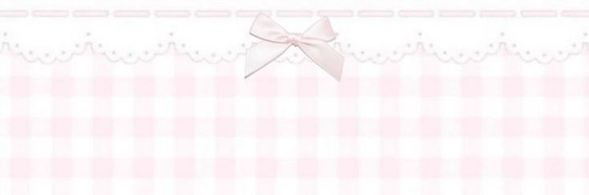

  

  

<h1 align="center">
  🌸 Lizzie's Github 🌸
</h1>

---

## 🌸 About Me
Hiyaa! I’m Liz/Louisa, a webdev student who loves:
- cute & unique UI designs  
- good looking designs  
- HTML/CSS/JS/PHP/MYSQLI
- learning animations & shaders  
- building cute‑styled websites, tho I can do more.
## 🌸 Languages
- I speak 4 languages:
- Dutch
- German
- English
- Swedish (I'm still partly learning swedish)  
## 🌸 Learning
- I'm also learning to make animations using shaders, three.js and more.
- I'm also learning to make minigames using javascript.
---

## 🌸 Tech Stack

  
  
  
  
  

---
## 🌸 Current Projects
My personal portofolio with:
- information about myself.
- contact information.
- a LIVE wallpaper that changes from sun to moon depending on ur laptops current time.
- Shader animations done with use of petals.

A mini videogame inspired by Priare King from Stardew Valley:
- cat entity (you play as the cat).
- mice enemies.
- ball of yarn as weapon.
- milk, catnip and more as buffs.
- different levels (working on this).

## 🌸 First Project
**Liz’s Boutique Webshop**  
A full CRUD webshop with:
- login & signup.  
- shopping cart.  
- product reviews.  
- sakura logo animation.  
- consistent layout across pages.  

---

## 🌸 Contact

  <b>GitHub:</b> @LizzieCodingg  
  <b>Email:</b> Louisasophie2008@gmail.com

